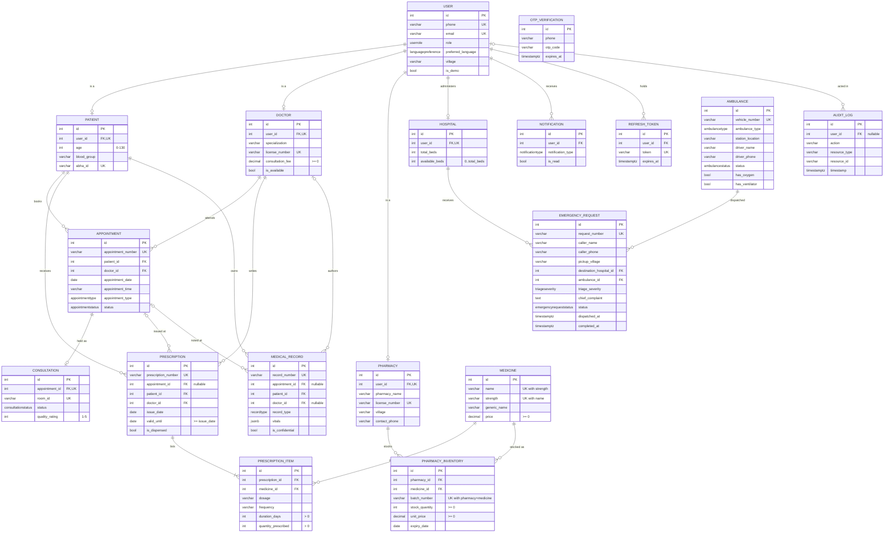

# Data model (ER)

Source of truth: [`server/prisma/schema.prisma`](../server/prisma/schema.prisma) plus the SQL-only rules in `server/prisma/migrations/`. Update this diagram when the schema changes.

## Rules the database enforces

| Rule | How |
|---|---|
| A prescription or record written at a visit names the **same patient and doctor** as that visit | Composite FK `(appointment_id, patient_id, doctor_id)` → `appointments(id, patient_id, doctor_id)` |
| A consultation's patient/doctor are the appointment's | Not stored on `consultations` at all (normalised away) |
| A doctor's time slot holds **one live booking** | Partial unique index on `(doctor_id, appointment_date, appointment_time) WHERE status = 'SCHEDULED'` |
| One catalogue entry per medicine strength | Unique `(name, strength)` |
| One row per pharmacy + medicine + batch | Unique `uq_pharmacy_medicine_batch` |
| Money has no rounding drift | `DECIMAL(10,2)` for fees and prices |
| No negative stock/prices; prescription items > 0; rating 1–5; `valid_until >= issue_date`; `available_beds <= total_beds` | `CHECK` constraints (migration `5_check_constraints`) |
| Visits with prescriptions can't be deleted out from under them | `ON DELETE NO ACTION` on the visit FKs |

## Not enforced by the database (application rules)

- A user's role matches the profile row it has (a `DOCTOR` user has a `doctors` row).
- Who may read a record: the patient, and doctors who have treated that patient; confidential records only the author.
